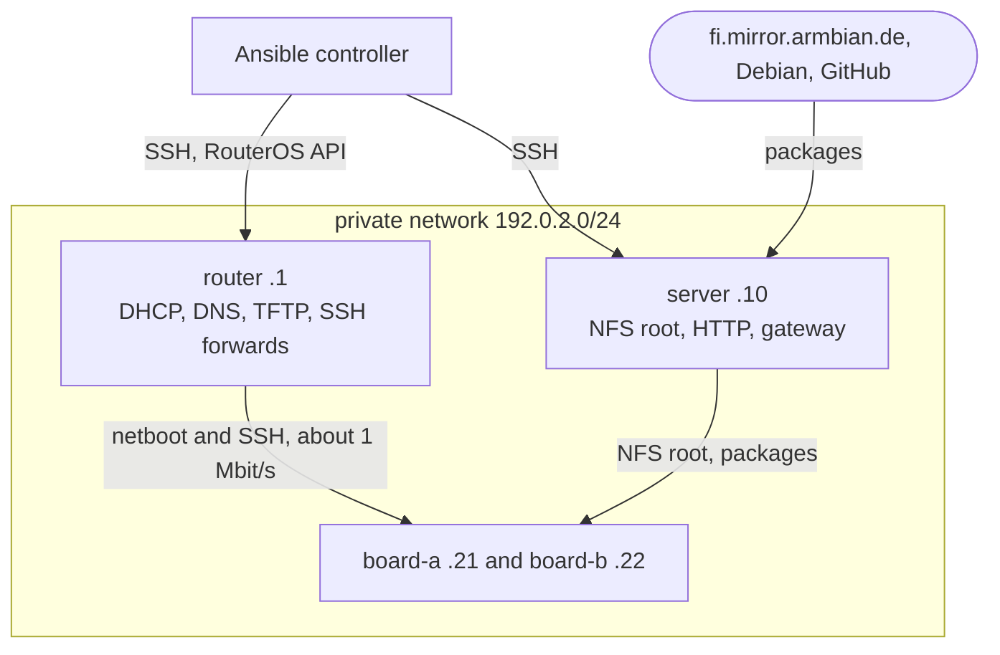

# armbian

A rehearsal of the Armbian board fleet's lifecycle on disposable virtual
machines. It runs the production playbooks, unmodified, against two stand-in
"boards" and checks that they end up the way a real board should: installed
from the network, booting from their own disk, and running k3s with its data
on a ZFS pool.

Reimaging a real board takes it out of the cluster, and a mistake on the
control plane takes the cluster down. This scenario is where a change to those
playbooks is tried first.

## Terms

| Term | Meaning |
| --- | --- |
| Boot mode | How a board starts. The fleet has four; this scenario uses two. In `nfs` it loads a kernel from the router over TFTP and mounts its root filesystem from the netboot server; that is how a blank board gets installed. In `local_kernel` it boots the kernel on its own disk; that is its normal state. |
| Pin | A small per-board file on the router, named after the board's MAC address, that selects the boot mode for the next boot. |
| Reimage | `playbooks/armbian/reimage.yaml`: stage a fresh image, pin `nfs`, reboot, create the automation user, partition and fill the local disk, pin `local_kernel`, reboot. |
| Preserved partition | A data partition that a reimage must leave untouched while it replaces the root filesystem. |
| Power-cycle hook | The task file that restarts a board (`armbian_power_cycle_tasks`). Workers are power-cycled; the control plane is rebooted over SSH. |
| DKMS guard | `playbooks/tasks/assert_dkms_built.yml`. It refuses a reboot when a kernel module built on the board (here ZFS) is missing for an installed kernel, because the board would come back without its pool. |

## The stand-ins

Four KubeVirt guests on a private network that exists only for the run.

| Guest | Stands in for | What it does |
| --- | --- | --- |
| `router` | The rb5009 router | RouterOS CHR 7.23.8: DHCP, DNS, TFTP for the pins, kernels and initrds, and one SSH port forward per board. |
| `server` | The NAS | Debian 13: publishes the Armbian image over HTTP and each board's root filesystem over NFS. |
| `board-a-vm` | A worker | Restarted by switching the VM off and on (`tasks/power_cycle_vm.yml`). |
| `board-b-vm` | The control plane, cm3588-nas-01 | Rebooted over SSH (`transport/power_cycle_warm_reboot.yml`), except during its first install, when it has no operating system to reboot. Has four extra 1 GiB disks for the ZFS pool, 8 cores and 4 GiB. |

The playbooks target the inventory hosts `board-a` and `board-b`. Those are
the installed boards, reached through the router's port forwards. `board-a-vm`
and `board-b-vm` are the same machines as the provisioner sees them.



## Run

You need a Casval lease and the `ocp-ansible-molecule` profile (see
`../README.md`), and `sshpass` on the controller, because a fresh Armbian
image is first reached with its default root password.

```bash
use ocp-ansible-molecule
oc whoami --show-server
molecule test -s armbian
```

A full run takes about 110 minutes (106 on Casval, 2026-11-26). Four reimages
account for most of it: each one netboots through the router, whose free
licence sends at about 1 Mbit/s, so loading the kernel and initrd alone takes
about 14 minutes.

The cluster must be able to reach `fi.mirror.armbian.de` (the image, about
1 GiB, and the boards' Armbian packages), `deb.debian.org`, `github.com`
(k3s), the registries of the k3s system images and `download.mikrotik.com`
(the CHR image, 45 MiB). The run creates nothing outside the `molecule`
namespace.

## What a run does

| Stage | What happens |
| --- | --- |
| `create` | Makes the private network (`network.yml`) and the four guests. |
| `prepare` | Sets up the server (NFS, nginx, the Armbian image), writes RouterOS to the router and configures it, and gives each board the small boot disk described under "What it cannot prove". |
| `converge` | Builds the cluster from zero, in the fleet runbook's order: reimage board-b, create its ZFS pool, reimage board-a, install k3s on both. |
| `verify` | First pass: checks the result (see "What it proves"). |
| `side_effect` | Gives both boards a second life. It leaves marker data behind, reimages board-a as a cluster member, breaks board-b's ZFS module so that the DKMS guard refuses, reimages board-b, imports the pool, reinstalls k3s, then upgrades board-b's kernel with the nightly update and reboots it. |
| `verify` | Second pass: the same checks, plus what a reimage must keep and what it must replace. |
| `destroy` | Removes the guests, then the network. |

There is no idempotence stage: a reimage rewrites a board's disks by design.
The second `verify` checks what a repeat run may and may not change.

### When a run fails

- `molecule test` destroys the guests even when a stage fails. To look at a
  failed board, run the stages one by one (below). If the cleanup itself
  fails, see `../README.md`.
- A 404 while `prepare` downloads the image, or apt not finding the kernel
  version, means Armbian has moved on. See "Upstream versions".
- `Timeout (12s) waiting for privilege escalation prompt` on one board while
  the other netboots is the router's rate limit, not a defect. The stages
  work on one board at a time for this reason.

### While developing

Keep the guests and run the stages one by one (`molecule create -s armbian`,
then `prepare`, `converge`, `verify`), and finish with
`molecule destroy -s armbian`. A stage file is the smallest unit Molecule
runs.

## What it proves

A reimage, on both boards:

- `stage_netboot_assets.yaml` turns an upstream Armbian image into a per-board
  NFS root on the server. The router fetches the kernel and initrd over HTTP
  and records their checksums. Staging again fetches nothing new.
- `pin_boot_mode.yaml` writes each board's own pin through the RouterOS API,
  and the router serves it.
- The `nfs` boot of the fresh image, `bootstrap.yaml` (automation user with a
  key, root locked), `provision_local_disks.yaml` (partitions, with one
  preserved) and the final `local_kernel` boot all work.
- Afterwards each board runs from partition 1 of its local disk with that
  disk's kernel. The router's log shows the board fetching its own pin, and
  no kernel or initrd, during that boot.

The control plane:

- `kubernetes/prepare-k3s-datastore.yml` builds the ZFS module for board-b's
  kernel and creates the pool of striped mirrors on its four disks.
- `kubernetes/install-k3s-cluster.yml` installs k3s on both boards. k3s
  starts on board-b only with its data directory mounted from the pool.
- After its first install, every reboot of board-b goes through the
  warm-reboot hook, which runs the DKMS guard.

The second lives:

- board-a is reimaged as a cluster member. `reimage.yaml` deletes its node
  and node-password secret from k3s, and the board can rejoin only because
  of that. (Its first reimage, before k3s exists, skips this step.)
- board-b is reimaged the way production's control plane was on 2026-11-25.
  Its ZFS module is uninstalled first, so the guard refuses a reboot. The
  reimage starts from that state, which proves the guard never blocks a
  reimage's first boot into `nfs`.
- After it, the pool is imported from its disks with the cluster's state
  intact (a ConfigMap written beforehand is still there), k3s is reinstalled
  on both boards, and board-a is never rebooted.
- On both boards the preserved partition keeps its data and the root
  filesystem is replaced.

A kernel upgrade on the control plane:

- `system-update.yaml` installs a newer kernel from apt.armbian.com, and
  Armbian's packaging rebuilds the ZFS module for it.
- The guard then passes, and `cycle_board.yaml` boots the new kernel with the
  pool online, both datasets mounted and both nodes Ready.

The router's bookkeeping:

- A kernel whose checksum changed on the router is fetched again.
- Four reimages leave one TFTP entry per directory and one checksum file per
  kernel, equal to the staged kernel.

## What it cannot prove

The boards are x86 virtual machines, not Rockchip boards:

- U-Boot and its environment. A VM boots PXELINUX from the router instead.
  Where a real board's U-Boot would then load the kernel from the local
  disk, the VM falls through to a small GRUB "carrier" disk, written by
  `prepare.yml`, that boots `/vmlinuz` from the disk labelled
  `armbi_root_local`.
- Rockchip kernels and device trees.
- PoE: `transport/power_cycle_poe.yml` is not exercised.
- Boot timing. The waits are the scenario's own and say nothing about a real
  board's.
- rb5009 itself. The CHR is reached on the plain API (port 8728), not
  api-ssl.

The test changes three things that production does not have:

- An older kernel on the control plane. The upstream image has no kernel
  headers and apt.armbian.com has none for its kernel, so
  `kernel_with_headers.yml` first installs an older apt kernel with its
  headers. Production's image is built with them (`INSTALL_HEADERS`). The
  image's own kernel therefore never runs under ZFS here.
- The server as the boards' gateway. On the fleet the router is the gateway.
  Here the router's DHCP hands out the server, because package downloads
  through the CHR would arrive at 1 Mbit/s.
- One fixed Armbian mirror. apt.armbian.com redirects each request to a
  mirror of its choosing, which can be slow or not yet synced. The router's
  DNS answers that name with the server, where nginx forwards to
  `fi.mirror.armbian.de`. A slow or stale mirror on the real fleet would not
  show up here.

Not covered at all:

- A kernel that the ZFS module cannot be built for. The upgrade stays within
  6.18.
- Drained nodes and running workloads.
- The fleet runbook's manual steps. One is done by hand here as the runbook
  says: deleting the control plane's node-password secret before its
  reimage.
- Finding a published image through its manifest. `prepare` publishes the
  upstream image on the server and `board_config_rootfs_src_override` points
  staging at it. The collection's `board_config` scenario covers the lookup.

## Upstream versions

Each is pinned and will need moving when its upstream drops it.

| Pin | Variable | Move it when |
| --- | --- | --- |
| Armbian image | `armbian_test_upstream_image` in `inventory/group_vars/all.yml` | `prepare` gets a 404. Armbian removes a point release when it publishes the next. Take the current `trixie_current_*_minimal` name from <https://dl.armbian.com/uefi-x86/archive/>. |
| Control-plane kernel | `armbian_test_kernel_version`, same file | apt no longer has it. It must stay the second newest `linux-image-current-x86`, so that the update finds a newer one: `apt-cache madison linux-image-current-x86`. |
| RouterOS CHR | `armbian_test_chr_version` and its checksum, same file | MikroTik withdraws the download. |
| k3s | `k3s_release_version` in `inventory/group_vars/rk8s.yml` | Production's version changes (igou-inventory `group_vars/rk8s.yml`). |

## Files

| File | Purpose |
| --- | --- |
| `molecule.yml` | The stage order. |
| `create.yml`, `destroy.yml`, `network.yml` | Guests and the private network. |
| `prepare.yml` | Server, router and boot disks, as above. |
| `converge.yml`, `side_effect.yml` | The first and second lives. Both only import production playbooks, apart from the faults `side_effect.yml` plants. |
| `kernel_with_headers.yml` | The older kernel described above. |
| `verify.yml` | Every check, with a second pass after `side_effect`. |
| `tasks/power_cycle_vm.yml` | The power-cycle hook for a VM. |
| `inventory/hosts.yml` | The guests, the boards and production's `rk8s` groups. |
| `inventory/group_vars/` | Production's variable names with test values. `all.yml` defines the guests and the pins. |
